# Active Directory Home Lab

I built this lab to get hands-on practice with the kind of work done on a help desk and in a SOC. It's a small Windows domain running in VirtualBox with a ticketing system for handling user issues and a SIEM for catching attacks run from a Kali machine.

Status: Parts 1 through 3 are done. Part 4 (help desk tickets) is in progress. I'm updating this as I finish each part.

## What's in the lab

| VM | OS | Role | IP |
|----|----|------|----|
| DC01 | Windows Server 2022 | Domain controller, DNS, DHCP | 192.168.50.10 |
| CLIENT01 | Windows 11 Enterprise | Domain-joined workstation | DHCP |
| SRV-UBUNTU | Ubuntu Server 24.04 | osTicket and Wazuh | 192.168.50.20 |
| KALI | Kali Linux | Attacker | 192.168.50.30 |

Domain: `jlab.local`
Network: VirtualBox NAT network, 192.168.50.0/24

<!-- TODO: network diagram -> screenshots/diagram.png, then add:  -->

## Tools and skills

Windows Server 2022, Windows 11, Active Directory, Group Policy, DNS, DHCP, PowerShell, VirtualBox

In progress: osTicket, Wazuh, Kali Linux, Nmap, Hydra

## 1. Domain controller

Installed Windows Server 2022 with the Desktop Experience, gave it a static IP of 192.168.50.10, and renamed it DC01.

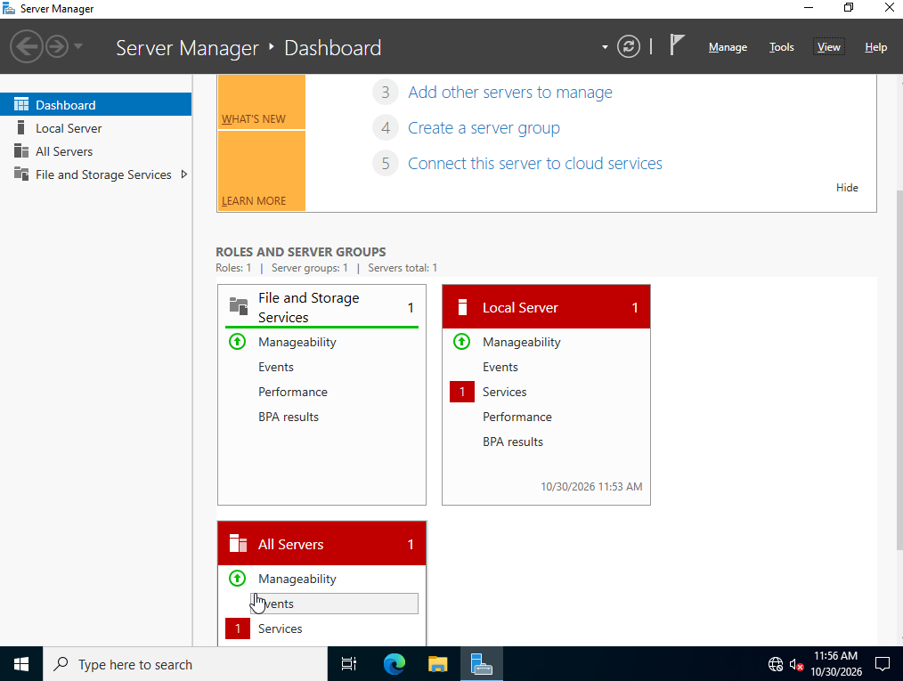
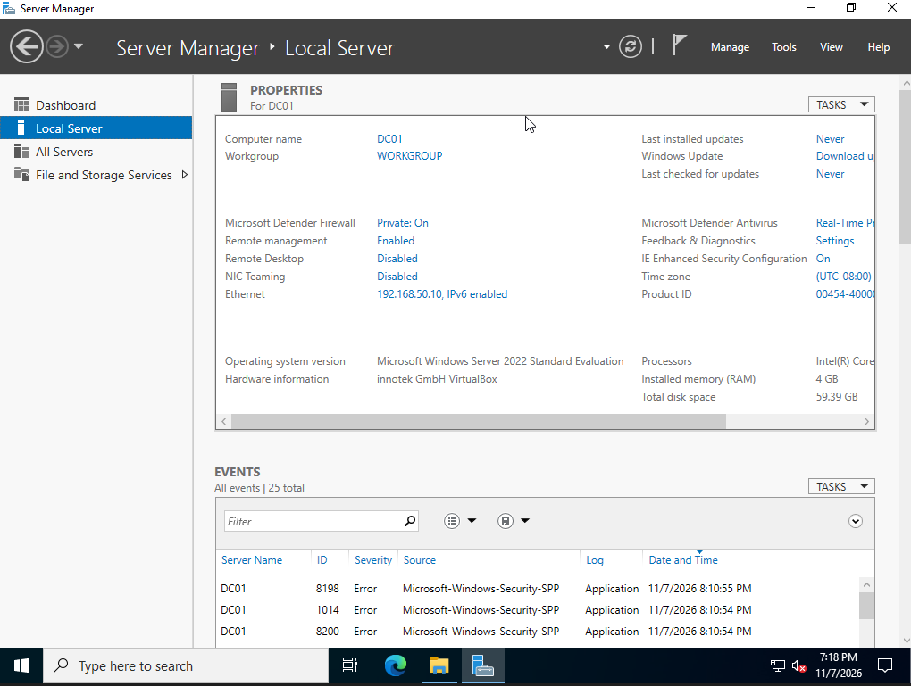

Then I installed AD DS and promoted it to a domain controller for a new forest, `jlab.local`.

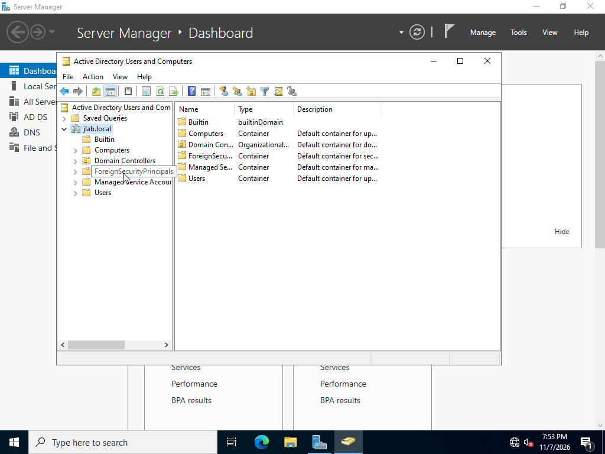

Last, I set up DHCP on the DC to hand out addresses from .100 to .200. The scope also gives out the router, the DC as the DNS server, and the domain name, so clients can find the domain without any manual setup.

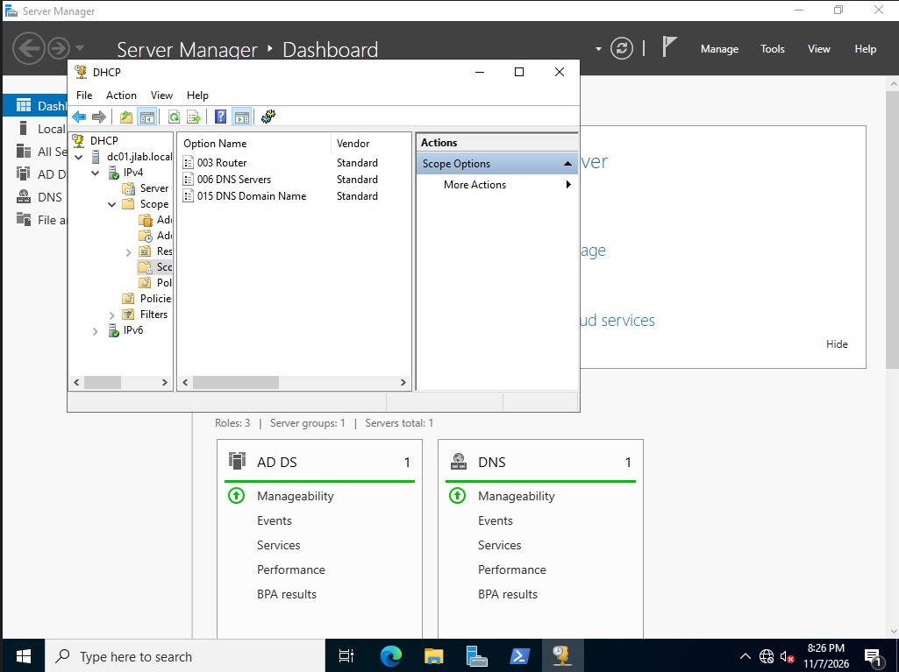

## 2. Users, OUs, and Group Policy

I put everything under one top-level OU called `JLab` so it's separate from the built-in containers:

```
JLab
├── Computers
├── Groups
└── Users
    ├── Finance
    ├── HR
    ├── IT
    ├── Marketing
    └── Sales
```

Then I wrote a PowerShell script ([scripts/create-users.ps1](scripts/create-users.ps1)) that reads a CSV of employees ([scripts/users.csv](scripts/users.csv)) and for each one:

- creates the department OU if it doesn't exist yet
- creates a security group for the department (`GRP-IT`, `GRP-HR`, and so on)
- creates the user with a first initial + last name username (Marcus Reed becomes `mreed`), sets their title and department, and forces a password change at first login
- adds them to their department group

It skips anyone who already exists, so it's safe to run more than once.

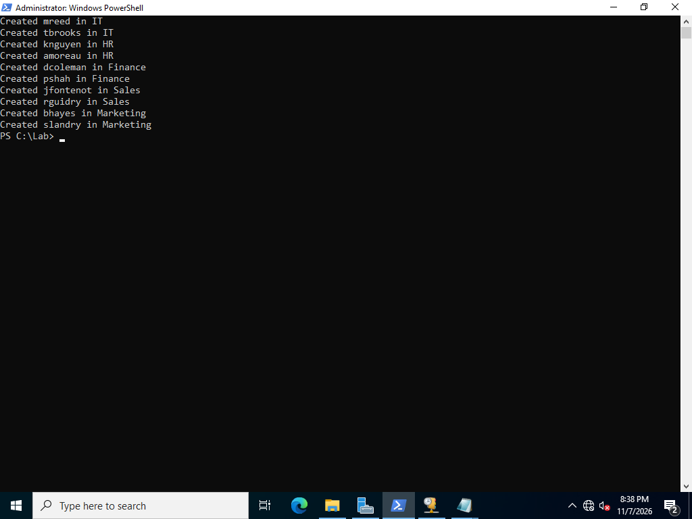
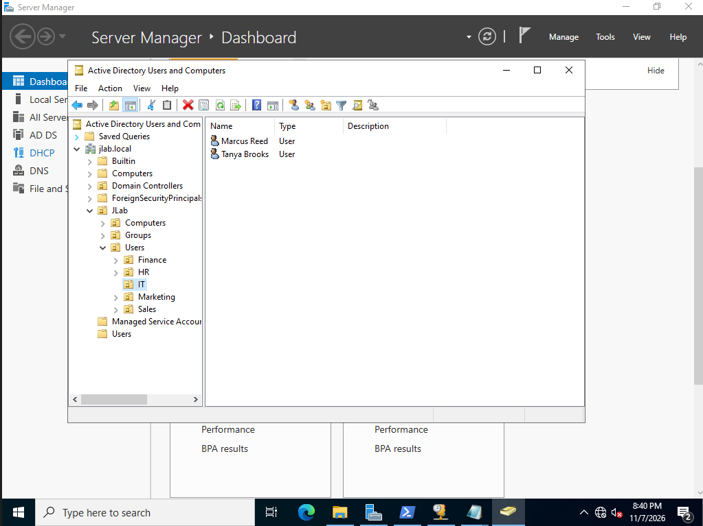

### Account lockout policy

In the Default Domain Policy I set accounts to lock after 5 failed logins. They stay locked for 30 minutes, and the failed login counter resets after 30 minutes. This has to go in the Default Domain Policy because lockout settings for domain accounts are only read from a GPO linked at the domain level.

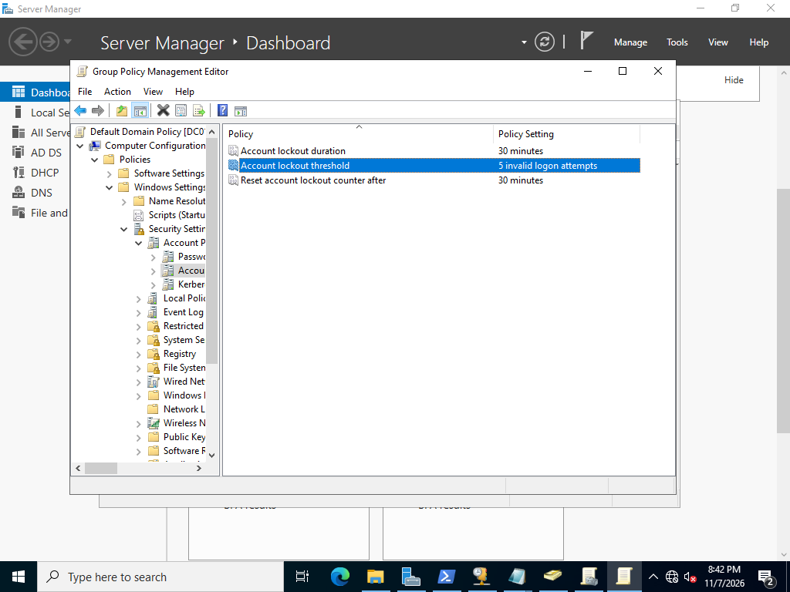

### Help desk delegation

A help desk tech shouldn't need to be a Domain Admin just to reset a password. I made a `GRP-HelpDesk` group, added Marcus Reed (the help desk technician) to it, and used the Delegation of Control Wizard on the `JLab\Users` OU to give that group only the right to reset passwords and force a password change at next logon.

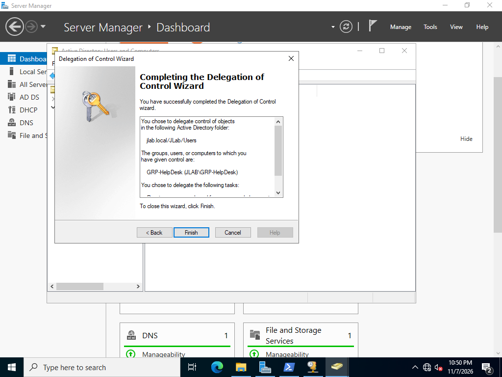

The wizard's built-in task only covers password resets, not unlocking accounts. Unlocking means writing to the `lockoutTime` attribute, so I granted that separately with `dsacls`:

```powershell
dsacls 'OU=Users,OU=JLab,DC=jlab,DC=local' /I:S /G 'JLAB\GRP-HelpDesk:RPWP;lockoutTime;user'
```

## 3. Joining a client to the domain

CLIENT01 is a Windows 11 Enterprise VM using EFI, TPM 2.0, and Secure Boot. During setup I picked "Domain join instead" so it got a local admin account rather than a Microsoft account.

Before joining, I checked that it pulled everything from the DC's DHCP scope: an address in the .100 to .200 range, DC01 as both the DHCP and DNS server, and `jlab.local` as the DNS suffix.

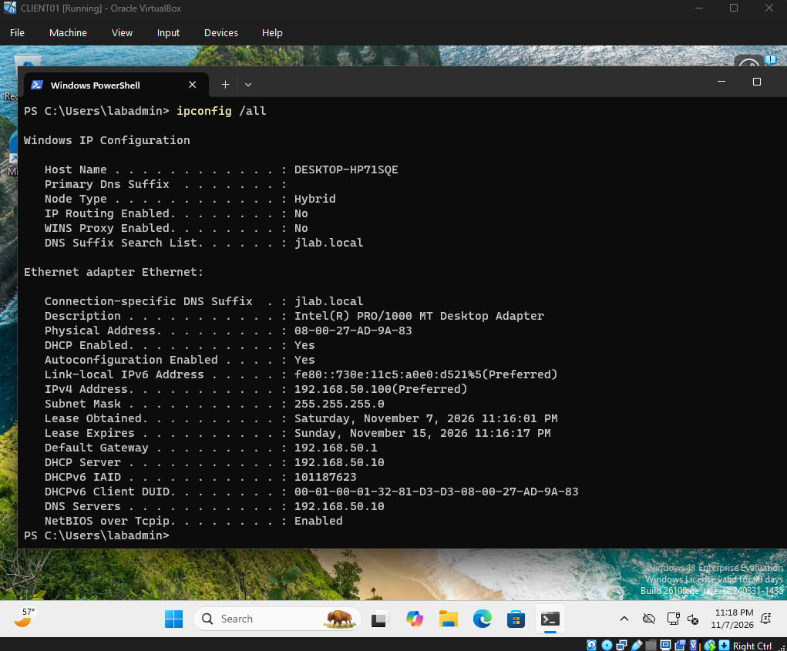

Then I renamed it and joined it to the domain in one command, placing it directly in the `JLab\Computers` OU instead of the default Computers container:

```powershell
Add-Computer -DomainName jlab.local -NewName CLIENT01 -OUPath "OU=Computers,OU=JLab,DC=jlab,DC=local" -Credential JLAB\Administrator -Restart
```

After the reboot I logged in as a domain user (`knguyen`). Since the script set "change password at next logon," Windows made the user pick a new password on first login.

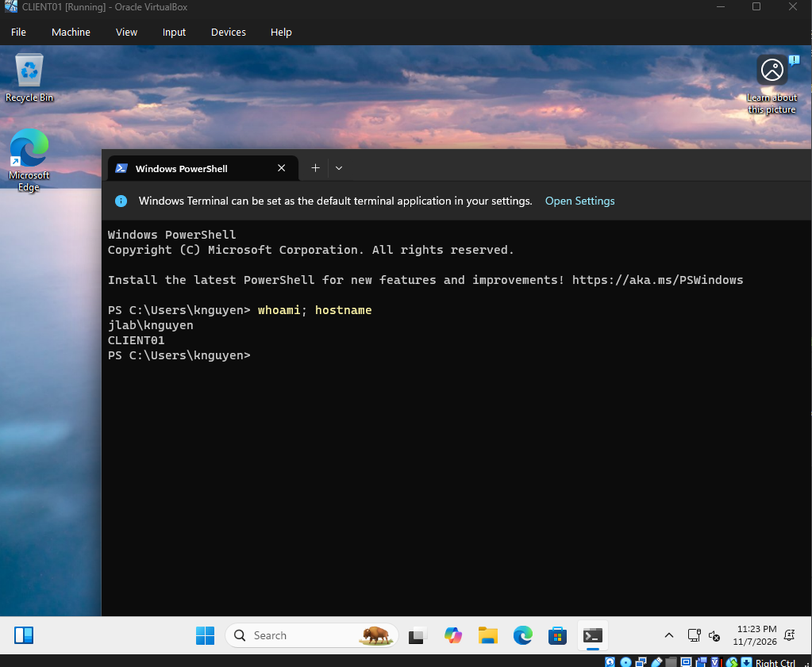

## 4. Help desk tickets (in progress)

<!-- TODO: one row per ticket -->
The plan is to set up osTicket on the Ubuntu server, then break things on purpose and work through them as tickets. osTicket isn't set up yet, but the first ticket scenario is underway.

| # | Issue | Cause | Fix |
|---|-------|-------|-----|
| 1 | User locked out | Too many failed logins hit the lockout policy | In progress <!-- TODO: unlock as mreed using delegated rights, confirm user can log in --> |
| 2 | | | |
| 3 | | | |

### Ticket 1: locked out user

To test the lockout policy, I signed in to CLIENT01 as `amoreau` with the wrong password until Windows locked the account.

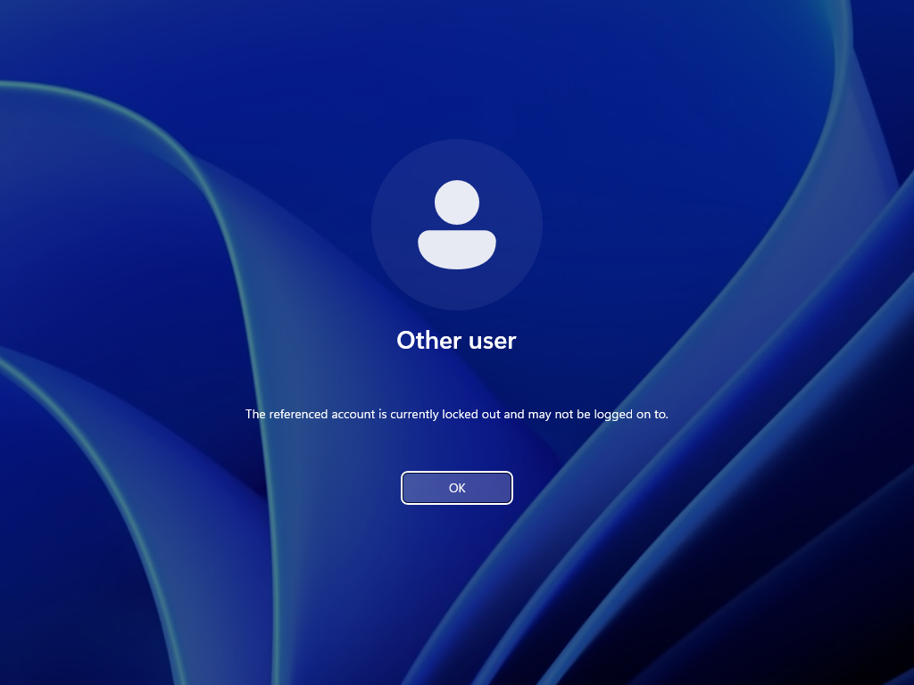

On the DC I confirmed the account was locked:

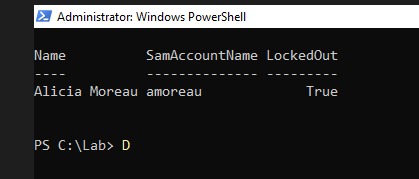

Next step (in progress): unlock the account as `mreed` from CLIENT01, using only the help desk rights delegated above.

<!-- TODO: unlock as mreed from CLIENT01 (RSAT + Unlock-ADAccount), add screenshots/unlocked.png -->

## 5. Detecting attacks with Wazuh (in progress)

<!-- TODO -->
The plan is to install Wazuh on the Ubuntu server, put agents on DC01 and CLIENT01, then run attacks from Kali and see what shows up. Not started yet.

| Attack | Tool | What Wazuh saw |
|--------|------|----------------|
| Port scan | Nmap | In progress |
| Password brute force | Hydra | In progress |

## Problems I ran into (in progress)

<!-- TODO: what broke and how you fixed it. Be specific. -->

## What I'd add next

- A file server with share permissions
- Sysmon for more detailed endpoint logs
- PowerShell scripts for onboarding and offboarding users
